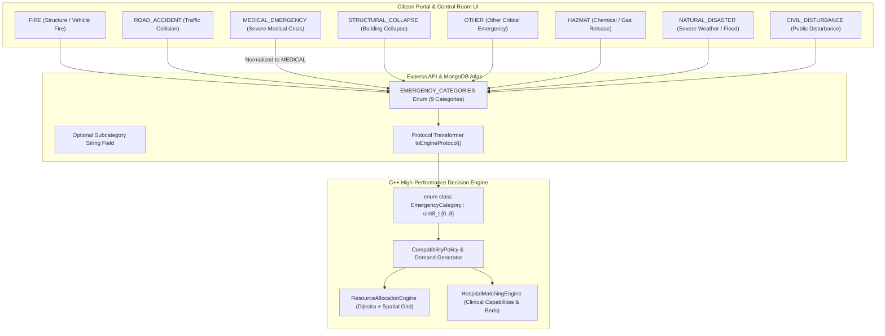

# Emergency Category Taxonomy & Complete Support Matrix
## Jodhpur Urban Service Area Emergency Resource Allocation & Response Management System

---

## 1. Executive Summary

During manual and integration verification, an alignment mismatch was detected between the Citizen Portal frontend and the backend emergency taxonomy:
- The **Citizen Portal** exposed eight user-facing emergency categories: `Structure / Vehicle Fire (FIRE)`, `Traffic Collision / Road Accident (ROAD_ACCIDENT)`, `Severe Medical Crisis / Trauma (MEDICAL_EMERGENCY)`, `Hazardous Chemical / Gas Release (HAZMAT)`, `Building / Infrastructure Collapse (STRUCTURAL_COLLAPSE)`, `Severe Weather / Flood Inundation (NATURAL_DISASTER)`, `Public Safety Disturbance (CIVIL_DISTURBANCE)`, and `Other Critical Emergency (OTHER)`.
- The **Backend Mongoose schema and validation** previously accepted only four keys: `MEDICAL`, `FIRE`, `ROAD_ACCIDENT`, and `INDUSTRIAL`.
- The **C++ Decision Engine** previously enforced bounds `category <= 3` (`MEDICAL`, `FIRE`, `ROAD_ACCIDENT`, `INDUSTRIAL`).

When a citizen selected any category outside those four, the submission was rejected with HTTP 400 `INVALID_CATEGORY`. Furthermore, had those categories passed to the engine, the engine bounds checks would have failed or attempted incompatible assignments without simulated equipment.

This document formalizes the canonical category taxonomy, explicit alias mapping, simulated fleet requirement definitions, C++ engine support, and user transparency measures.

---

## 2. Canonical Category Taxonomy & Aliasing Architecture

The system standardizes on a unified taxonomy covering all 8 Citizen Portal options, alongside backend canonical entries:

### Protocol Normalization
- `MEDICAL_EMERGENCY` is preserved as a valid intake value in the database, while `toEngineProtocol()` normalizes it to canonical `MEDICAL` for C++ protocol serialization.
- `JsonConverters.cpp` in the C++ engine parses both `"MEDICAL"` and `"MEDICAL_EMERGENCY"` to `EmergencyCategory::MEDICAL` (enum 0).
- `subcategory` is now supported across the schema, controller, and query responses to capture granular situational details (e.g. chemical type, structure height) without breaking the core decision engine.

---

## 3. Simulated Fleet Reality & Prototype Boundaries

The academic simulation dataset seeded into MongoDB for the Jodhpur Urban Service Area comprises **15 simulated emergency fleet assets** and **3 tertiary hospital facilities**:

### Available Prototype Fleet (15 Vehicles)
- **Advanced Life Support (ALS) Ambulances (4 units):** #101, #102 (AIIMS Depot), #301 (Paota Depot), #401 (Shastri Nagar).
- **Basic Life Support (BLS) Ambulances (3 units):** #103 (AIIMS Depot), #302 (Paota Depot), #402 (Shastri Nagar).
- **Fire Engines / Pumpers (3 units):** #201, #202 (Basni Station), #304 (Paota Depot).
- **Fire Water/Foam Tenders (2 units):** #203 (Basni Station), #501 (Jalori Gate Post).
- **Heavy Rescue Vehicles (3 units):** #204 (Basni Station), #305 (Paota Depot), #502 (Jalori Gate Post).

### Operational Fleet Boundary
- The prototype fleet consists strictly of municipal **Fire & Rescue** and **EMS / Ambulance** apparatus.
- **Specialized chemical containment apparatus (HazMat)**, **water rescue boats / amphibious floodcraft**, and **law enforcement / police tactical units** are deliberately not fabricated in the simulation dataset.
- Rather than returning silent or arbitrary vehicle substitutions, the engine marks these categories as `NO_COMPATIBLE_RESOURCES` with explicit status messages explaining the shortage.

---

## 4. Master Category Support Matrix

| Category Key | Citizen Portal Label | Backend Acceptance | C++ Enum ID | Simulated Fleet Vehicle Requirements | Required Hospital Clinical Capabilities | Simulated Fleet Support Status | Engine Behavior & Summary Notes |
|---|---|---|---|---|---|---|---|
| **`FIRE`** | Structure / Vehicle Fire | `FIRE` | `1` | 1× `FIRE_ENGINE` 1× `FIRE_TENDER` 1× `BLS_AMBULANCE` | `GENERAL_EMERGENCY` `BURN_TREATMENT` `OXYGEN_SUPPORT` (1 General, 1 Oxygen bed) | **Fully Supported** | Allocates closest engine, tender, and ambulance. Recommends burn-capable hospital (e.g., MGH or AIIMS). Status: `FULLY_DISPATCHED`. |
| **`ROAD_ACCIDENT`** | Traffic Collision / Road Accident | `ROAD_ACCIDENT` | `2` | 1× `ALS_AMBULANCE` 1× `RESCUE_VEHICLE` (Victims − 1)× `BLS_AMBULANCE` | `GENERAL_EMERGENCY` `TRAUMA` `SURGICAL_SUPPORT` (1 General, 1 ICU bed) | **Fully Supported** | Allocates closest ALS ambulance and heavy rescue vehicle for extrication. Recommends trauma center (MDM / AIIMS / MGH). Status: `FULLY_DISPATCHED`. |
| **`MEDICAL`** / **`MEDICAL_EMERGENCY`** | Severe Medical Crisis / Trauma | `MEDICAL_EMERGENCY` or `MEDICAL` | `0` | If Sev ≥ 4 or Victims ≥ 2: 1× `ALS_AMBULANCE` Else: 1× `BLS_AMBULANCE` Additional victims: `BLS_AMBULANCE` | `GENERAL_EMERGENCY` (1 General bed; ICU if Sev ≥ 4) | **Fully Supported** | Dispatches ALS or BLS ambulance by severity. Recommends closest hospital with bed availability. Status: `FULLY_DISPATCHED`. |
| **`STRUCTURAL_COLLAPSE`** | Building / Infrastructure Collapse | `STRUCTURAL_COLLAPSE` | `4` | 1× `RESCUE_VEHICLE` 1× `FIRE_ENGINE` 1× `ALS_AMBULANCE` (Victims − 1)× `BLS_AMBULANCE` | `GENERAL_EMERGENCY` `TRAUMA` `ICU` (1 General, 1 ICU bed) | **Fully Supported** | Dispatches rescue unit for shoring/search, fire engine for hazard mitigation, and ALS for casualties. Recommends trauma center. Status: `FULLY_DISPATCHED`. |
| **`INDUSTRIAL`** | Industrial Emergency | `INDUSTRIAL` | `3` | 1× `FIRE_ENGINE` 1× `FIRE_TENDER` 1× `RESCUE_VEHICLE` 1× `ALS_AMBULANCE` | `GENERAL_EMERGENCY` `TRAUMA` `BURN_TREATMENT` `OXYGEN_SUPPORT` (1 General, 1 ICU, 1 Oxygen bed) | **Fully Supported** | Dispatches comprehensive multi-type industrial response. Recommends full-capability trauma and burn facility. Status: `FULLY_DISPATCHED`. |
| **`OTHER`** | Other Critical Emergency | `OTHER` | `8` | If Sev ≥ 4: 1× `ALS_AMBULANCE` Else: 1× `BLS_AMBULANCE` | `GENERAL_EMERGENCY` (1 General bed) | **Fully Supported (General First Responder Assessment)** | Dispatches first-responder ambulance for on-scene assessment and triage. Recommends nearest general ER. Status: `FULLY_DISPATCHED`. |
| **`HAZMAT`** | Hazardous Chemical / Gas Release | `HAZMAT` | `5` | Specialized HazMat Containment Unit *(Not in prototype fleet)* | `GENERAL_EMERGENCY` `OXYGEN_SUPPORT` `BURN_TREATMENT` (1 General, 1 Oxygen bed) | **Unsupported in Prototype Fleet** | Evaluates hospital match for toxic exposure. Returns `NO_COMPATIBLE_RESOURCES` with status note: *"Specialized chemical/HAZMAT containment apparatus required but not available in prototype emergency fleet"*. Dispatch confirmation safely blocked. |
| **`NATURAL_DISASTER`** | Severe Weather / Flood Inundation | `NATURAL_DISASTER` | `6` | Specialized Amphibious Rescue / Boat Unit *(Not in prototype fleet)* | `GENERAL_EMERGENCY` `TRAUMA` (1 General bed) | **Unsupported in Prototype Fleet** | Evaluates hospital match. Returns `NO_COMPATIBLE_RESOURCES` with status note: *"Specialized flood/water rescue apparatus required but not available in prototype emergency fleet"*. Dispatch confirmation safely blocked. |
| **`CIVIL_DISTURBANCE`** | Public Safety Disturbance | `CIVIL_DISTURBANCE` | `7` | Law Enforcement / Police Tactical Units *(Not in fire/EMS prototype fleet)* | `GENERAL_EMERGENCY` `TRAUMA` (1 General bed) | **Unsupported in Prototype Fleet** | Evaluates hospital match. Returns `NO_COMPATIBLE_RESOURCES` with status note: *"Law enforcement / police response units required but not available in fire/EMS simulation prototype fleet"*. Dispatch confirmation safely blocked. |

---

## 5. Frontend & Control Room Transparency Measures

To prevent citizen confusion and provide complete clarity in the Control Room:

1. **Citizen Portal Warning Banner (`CitizenReportEmergency.jsx`):**
   When a user selects `HAZMAT`, `NATURAL_DISASTER`, or `CIVIL_DISTURBANCE`, an inline informational banner dynamically appears:
   > **Specialized Equipment Notice:** This category requires specialized equipment (HAZMAT containment, flood rescue apparatus, or law enforcement units) outside the standard prototype fire/EMS fleet. The simulation engine will evaluate hospital matches and document equipment shortages accordingly.

2. **Control Room Incident Queue Filter (`IncidentQueuePage.jsx`):**
   The category filter dropdown includes all categories (`All Categories`, `Structure / Vehicle Fire`, `Traffic Collision / Road Accident`, `Severe Medical Crisis / Trauma`, `Medical (General)`, `Hazardous Chemical / Gas Release`, `Building / Infrastructure Collapse`, `Severe Weather / Flood Inundation`, `Public Safety Disturbance`, `Industrial Incident`, `Other Critical Emergency`).

3. **Dispatch Planner Explanations (`DispatchPlannerPage.jsx`):**
   When viewing recommendations, if an incident cannot be allocated due to missing specialist assets, the badge displays `HOSPITAL_FOUND_NO_RESOURCES` or `UNABLE_TO_DISPATCH`, and the exact C++ summary notes are rendered inline:
   - *"Specialized chemical/HAZMAT containment apparatus required but not available in prototype emergency fleet"*
   - *"Specialized flood/water rescue apparatus required but not available in prototype emergency fleet"*
   - *"Law enforcement / police response units required but not available in fire/EMS simulation prototype fleet"*
   - The UI correctly prevents confirming or executing any dispatch recommendation with zero resources allocated.

---

## 6. Verification & Automated Test Coverage

The implementation has been verified with automated regression and integration test suites:

| Suite | Component | Tests Run | Result | Key Checks Verified |
|---|---|---|---|---|
| **C++ Core Unit Tests** | `test_priority_engine.exe` | 29 | **PASSED** | 9-category enum range, priority scoring invariance across all categories, overflow protection |
| **C++ Allocation Tests** | `test_resource_allocation.exe` | 13 | **PASSED** | Bounds check `category <= 8`, multi-type requirements for `STRUCTURAL_COLLAPSE` and `OTHER`, rejection for missing fleet assets |
| **C++ Hospital Matching** | `test_hospital_matching.exe` | 13 | **PASSED** | Clinical capability matching for burns, trauma, ICU across all categories, coordinate snapping |
| **C++ Orchestrator Tests** | `test_dispatch_orchestrator.exe` | 9 | **PASSED** | Simultaneous multi-incident batch dispatch with conflict prevention and descriptive shortage summary notes |
| **C++ JSON Protocol** | `test_json_protocol.exe` | 6 | **PASSED** | Parsing string and integer categories [0..8], stdin/stdout streaming interface |
| **Category Alignment Regression** | `categoryAlignment.test.js` | 11 | **PASSED** | Schema validation, `toEngineProtocol()` normalization, intake 201 for all 8 categories, 400 rejection for invalid category, live C++ engine dispatch |
| **Full Backend Test Suite** | `npm --prefix server test` | 227 | **PASSED** | All active tracking, MongoDB transactions, dispatch idempotency, auth, and seeder tests passing (0 failures) |
| **Frontend Unit & Integration** | `npm --prefix client test` | 92 | **PASSED** | Citizen portal intake validation, control room queue filters, and lifecycle timeline progression (0 failures) |
| **Frontend Production Build** | `npm --prefix client run build` | — | **PASSED** | Clean Vite production bundle generated in 12.92s with zero JSX/syntax warnings |
