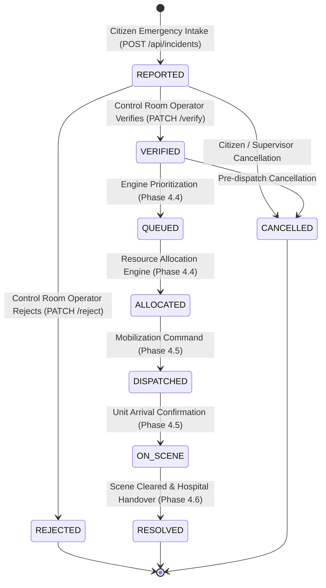

# Emergency Incident Lifecycle & State Machine

> **ACADEMIC SIMULATION PROXY DISCLAIMER**  
> This specification defines the state transitions for the academic emergency dispatch simulation platform for Jodhpur, Rajasthan. It models standard emergency service operational lifecycles for educational and computational analysis.

---

## 1. Lifecycle State Machine Overview

The emergency incident lifecycle spans nine distinct statuses from initial intake through terminal resolution or rejection:

| Status | Category | Description | Phase |
|---|---|---|---|
| `REPORTED` | Initial | Incident submitted by citizen or intake operator; pending verification. | 4.2 |
| `VERIFIED` | Active | Confirmed genuine emergency; ready for prioritization & resource allocation. | 4.3 |
| `QUEUED` | Active | Validated and prioritized, awaiting resource availability. | 4.4 |
| `ALLOCATED` | Active | C++ decision engine assigned vehicles and target hospitals. | 4.4 |
| `DISPATCHED` | Active | Emergency units mobilized and in transit toward the scene. | 4.5 |
| `ON_SCENE` | Active | First responders arrived at coordinates; active operations underway. | 4.5 |
| `RESOLVED` | Terminal | Incident mitigated, casualties evacuated, operations closed. | 4.6 |
| `REJECTED` | Terminal | Invalid, prank, duplicate, or unverified report discarded. | 4.3 |
| `CANCELLED` | Terminal | Incident cancelled by reporter or supervisor prior to unit arrival. | 4.6 |

---

## 2. State Transition Diagram

### 2.1. Mermaid State Diagram



### 2.2. ASCII State Transition Diagram

```
                 ┌─────────────────────────────────┐
                 │      [POST /api/incidents]      │
                 │             (Citizen)           │
                 └────────────────┬────────────────┘
                                  │
                                  ▼
                 ┌─────────────────────────────────┐
                 │           REPORTED              │◄── (Initial Intake State)
                 └───────┬─────────────────┬───────┘
                         │                 │
         [PATCH /verify] │                 │ [PATCH /reject]
              (Operator) │                 │ (Operator)
                         ▼                 ▼
             ┌───────────────┐     ┌───────────────┐
             │   VERIFIED    │     │   REJECTED    │◄── (Terminal State)
             └───────┬───────┘     └───────────────┘
                     │
                     ▼  (Phase 4.4 Engine Orchestration)
             ┌───────────────┐
             │    QUEUED     │
             └───────┬───────┘
                     │
                     ▼  (Phase 4.4 C++ Allocation)
             ┌───────────────┐
             │   ALLOCATED   │
             └───────┬───────┘
                     │
                     ▼  (Phase 4.5 Field Mobilization)
             ┌───────────────┐
             │  DISPATCHED   │
             └───────┬───────┘
                     │
                     ▼  (Phase 4.5 Arrival)
             ┌───────────────┐
             │   ON_SCENE    │
             └───────┬───────┘
                     │
                     ▼  (Phase 4.6 Closure)
             ┌───────────────┐
             │   RESOLVED    │◄── (Terminal State)
             └───────────────┘
```

---

## 3. Transition Rules & Phase Scopes

### Phase 4.3 Scope: Intake & Verification Transitions

#### Transition 1: `REPORTED` $\rightarrow$ `VERIFIED`
- **Authorized Roles**: `OPERATOR`, `ADMIN`.
- **Precondition**: Current document status must equal `REPORTED`.
- **Action**: Operator attaches optional `verificationNotes` (max 1000 chars).
- **Effects**:
  - `status` set to `VERIFIED`.
  - `verifiedBy` set to operator's user ObjectId.
  - `verifiedAt` set to server timestamp `Date.now()`.
  - `verificationNotes` persisted.
  - Entry appended to `auditHistory`.
- **Postcondition**: Incident becomes eligible for Phase 4.4 automated allocation queue.

#### Transition 2: `REPORTED` $\rightarrow$ `REJECTED`
- **Authorized Roles**: `OPERATOR`, `ADMIN`.
- **Precondition**: Current document status must equal `REPORTED`.
- **Action**: Operator supplies mandatory `rejectionReason` (3–1000 chars).
- **Effects**:
  - `status` set to `REJECTED`.
  - `rejectedBy` set to operator's user ObjectId.
  - `rejectedAt` set to server timestamp `Date.now()`.
  - `rejectionReason` persisted.
  - Entry appended to `auditHistory`.
- **Postcondition**: Incident enters permanent terminal state; cannot be verified or mobilized.

---

## 4. Terminal State Invariants

1. **Immutability of Terminal States**:
   - Once an incident transitions to `REJECTED`, `RESOLVED`, or `CANCELLED`, it cannot undergo further status transitions.
   - Any API attempt to verify, reject, allocate, or modify a terminal incident returns HTTP 409 Conflict (`INCIDENT_STATE_CONFLICT`).
2. **Audit Preservation**:
   - The terminal status and reason are permanently recorded in both root fields (`rejectionReason`) and within the structured `auditHistory` log.
3. **Resource Safety**:
   - A `REJECTED` incident is strictly ignored by the Phase 4.4 multi-incident dispatch orchestrator and priority scoring engine.

---

## 5. Security & Access Control Matrix

| Endpoint | CITIZEN | OPERATOR | ADMIN |
|---|---|---|---|
| `POST /api/incidents` | Allowed | Allowed | Allowed |
| `GET /api/incidents/my` | Own reports only | Own reports only | Own reports only |
| `GET /api/incidents/:id` | Own report only (403 if other) | All incidents | All incidents |
| `GET /api/incidents` | 403 Forbidden | All incidents + filters | All incidents + filters |
| `PATCH /api/incidents/:id/verify` | 403 Forbidden | Allowed (REPORTED only) | Allowed (REPORTED only) |
| `PATCH /api/incidents/:id/reject` | 403 Forbidden | Allowed (REPORTED only) | Allowed (REPORTED only) |

