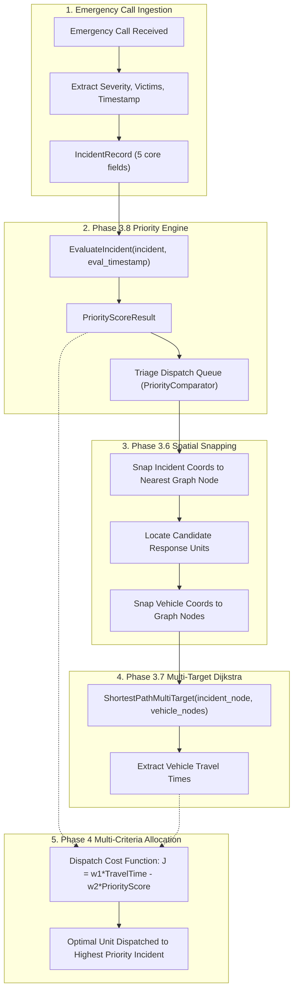

# Phase 3.8 Technical Implementation Plan — Emergency Priority Scoring Engine

**Project:** Emergency Resource Allocation & Response Management System for Jodhpur  
**Document Type:** Technical Architecture Inspection & Implementation Plan (Audited & Remediated)  
**Status:** PLANNING ONLY — NO CODE MODIFICATIONS  
**Target Phase:** Phase 3.8  

---

## 1. Executive Summary & Objective

The objective of Phase 3.8 is to design and implement a standalone, deterministic, configurable **Emergency Priority Scoring Engine** for the Jodhpur Emergency Response System.

In an active urban emergency environment, incoming incidents (e.g., multi-vehicle collisions, structure fires, acute cardiac emergencies, industrial hazardous material spills) arrive asynchronously. Before allocating vehicles or computing transit routes, the control room decision-support system must assign each incident a normalized **Priority Score** $P \in [0.0, 100.0]$ to establish triage ordering.

The academic simulation model proposes the weighted composite formulation:
$$\text{Priority Score} = (\text{Severity Score} \times 0.50) + (\text{Victim Score} \times 0.30) + (\text{Waiting Score} \times 0.20)$$

> [!IMPORTANT]
> **Educational & Academic Proxy Notice:**  
> This priority engine is an educational decision-support simulation proxy designed for algorithmic study of multi-criteria resource dispatch. It is **NOT** a clinically or legally validated triage protocol (such as START, SALT, or Manchester Triage).

---

## 2. Architecture Inspection

### 2.1 Existing Repository Layout & Component Inspection
Inspection of `cpp_engine/` reveals the following architectural baseline:
- **Core Library (`librouting_core.a`):**
  - Graph model & ingestion: `Graph.hpp/cpp`, `GraphTypes.hpp`, `DataLoader.hpp/cpp`.
  - Topology & integrity: `GraphIntegrity.hpp/cpp`, `GraphConnectivity.hpp/cpp`.
  - Pathfinding: `Dijkstra.hpp/cpp` (single-pair, all-nodes, and multi-target).
  - Geometry & serialization: `RouteGeometry.hpp/cpp`, `GeoJSONExporter.hpp/cpp`, `PolylineEncoder.hpp/cpp`.
  - Spatial indexing: `SpatialGrid.hpp/cpp`, `BoundaryValidator.hpp/cpp`.
- **Pre-existing Priority Logic:** None. The routing engine is purely geometric and topological. Graph edges store physical distance in meters, road classifications, and geometry buffers. No incident triage, urgency weighting, or priority structures exist in the C++ engine.
- **CMake Organization (`cpp_engine/CMakeLists.txt`):**
  - C++17 standard enforced (`CMAKE_CXX_STANDARD 17`).
  - Strict compiler warning flags (`-Wall -Wextra -pedantic -O3`).
  - All core components compile into `routing_core` static library.
  - Dedicated standalone test executables in `cpp_engine/bin/`.
- **Testing Conventions:**
  - Macro-based assertions (`TEST_ASSERT(cond, msg)`, `EXPECT_THROW(stmt, ex_type, msg)`).
  - Structured output reporting passed/failed checks and execution time.
  - Test suites return 0 on complete success, 1 on failure.

### 2.2 Decoupling Strategy: Zero Coupling with `DijkstraRouter`
The Emergency Priority Engine will be designed as an independent module (`PriorityEngine.hpp` and `PriorityEngine.cpp`) with **zero direct dependency** on `DijkstraRouter` or `Graph`:
- Priority scoring depends strictly on incident attributes (severity, casualties, waiting time).
- It does not require road network nodes, edge weights, or coordinate snapping.
- **Benefits:**
  - Independent unit testing and micro-benchmarking without loading the 59,334-node canonical graph.
  - Ultra-high throughput (>1,000,000 evaluations/sec) with zero memory allocation inside the hot scoring path.
  - Reusable across various dispatch paradigms (e.g., pre-routing incident queuing, post-routing multi-criteria objective ranking).

---

## 3. Simplified Input Model & Data Structures

Following the independent planning audit, `IncidentRecord` contains **strictly the 5 fields required for priority evaluation**. Geographic coordinates (`latitude`, `longitude`) are excluded from the priority engine; coordinate validation and snapping belong exclusively to `BoundaryValidator` and `SpatialGrid` in the spatial routing pipeline.

The structures reside in `EmergencyRouting::Priority` within `cpp_engine/include/PriorityEngine.hpp`:

```cpp
namespace EmergencyRouting {
namespace Priority {

/**
 * Emergency incident domain category.
 * Strictly validated against [0, 3].
 */
enum class EmergencyCategory : uint8_t {
    MEDICAL = 0,
    FIRE = 1,
    ROAD_ACCIDENT = 2,
    INDUSTRIAL = 3
};

/**
 * Triage urgency classification tier.
 */
enum class PriorityTier : uint8_t {
    LOW = 0,
    MEDIUM = 1,
    HIGH = 2,
    CRITICAL = 3
};

/**
 * Simplified incident input record containing only priority scoring attributes.
 * Geographic attributes are deliberately excluded and managed by spatial layers.
 */
struct IncidentRecord {
    uint64_t incident_id{0};                  // Unique non-zero incident identifier
    EmergencyCategory category{EmergencyCategory::MEDICAL};
    uint32_t severity{1};                     // Integer severity scale: 1 (Minor) to 5 (Catastrophic)
    uint32_t victim_count{0};                 // Number of confirmed/estimated victims (>= 0)
    uint64_t created_at_ms{0};                // Unix epoch timestamp (milliseconds) of call creation
};

/**
 * Validation result for PriorityConfig.
 */
struct ConfigValidationResult {
    bool is_valid{true};
    std::string error_message;
};

/**
 * Configurable weights, thresholds, and saturation parameters for the scoring algorithm.
 */
struct PriorityConfig {
    // Component weights (must be finite, >= 0, non-zero sum, and sum to 1.0 within 1e-6)
    double severity_weight{0.50};
    double victim_weight{0.30};
    double waiting_weight{0.20};

    // Severity mapping
    uint32_t min_severity{1};
    uint32_t max_severity{5};

    // Victim saturation parameters
    uint32_t max_victim_saturation{20};       // Victim count where victim score reaches 100.0

    // Waiting time saturation parameters
    uint64_t max_waiting_time_ms{3600000};    // 60 minutes in milliseconds (saturation point)

    // Tier score boundary thresholds: [lower_bound, upper_bound)
    double medium_threshold{40.0};
    double high_threshold{60.0};
    double critical_threshold{80.0};

    /**
     * Strict validation of configuration parameters.
     * Rejects NaN, Inf, negative weights, all-zero weights, and non-unitary sums.
     */
    ConfigValidationResult Validate() const noexcept;
};

/**
 * Complete evaluation result for an incident.
 * Contains score breakdowns, unrounded total score, classified tier, and tie-breaking attributes.
 */
struct PriorityScoreResult {
    uint64_t incident_id{0};
    bool is_valid{false};
    std::string error_message;

    // Cached attributes for self-contained canonical comparator ordering
    uint32_t severity{0};
    uint32_t victim_count{0};
    uint64_t waiting_duration_ms{0};           // Evaluated duration (evaluated_at_ms - created_at_ms)

    // Normalized components in [0.0, 100.0]
    double normalized_severity_score{0.0};
    double normalized_victim_score{0.0};
    double normalized_waiting_score{0.0};

    // Unrounded composite score in [0.0, 100.0]
    double total_priority_score{0.0};

    // Triage tier classification (derived from unrounded total_priority_score)
    PriorityTier tier{PriorityTier::LOW};
};

/**
 * Canonical deterministic comparator for batch sorting and priority-queue dispatch.
 * Implements strict weak ordering (strict total order on distinct incident_ids).
 */
struct PriorityComparator {
    bool operator()(const PriorityScoreResult& a, const PriorityScoreResult& b) const noexcept;
};

} // namespace Priority
} // namespace EmergencyRouting
```

---

## 4. Mathematical Scoring Model & Precision Policy

### 4.1 Scoring Formula
The composite score $P \in [0.0, 100.0]$ is computed as:
$$P = \left( W_S \times S_{\text{norm}} \right) + \left( W_V \times V_{\text{norm}} \right) + \left( W_W \times T_{\text{norm}} \right)$$

where $W_S + W_V + W_W = 1.0$, $W_i \ge 0.0$.

### 4.2 Component Normalization
1. **Severity Normalization ($S_{\text{norm}} \in [20.0, 100.0]$):**
   $$S_{\text{norm}} = \frac{S}{S_{\max}} \times 100.0 = \frac{S}{5} \times 100.0$$
   - Severity 1 (Minor): $20.0$
   - Severity 2 (Moderate): $40.0$
   - Severity 3 (Serious): $60.0$
   - Severity 4 (Severe): $80.0$
   - Severity 5 (Catastrophic): $100.0$
2. **Victim Normalization ($V_{\text{norm}} \in [0.0, 100.0]$):**
   - $V = 0 \implies V_{\text{norm}} = 0.0$.
   - $V > 0 \implies V_{\text{norm}} = \min\left(100.0, \frac{V}{V_{\text{sat}}} \times 100.0\right)$ with $V_{\text{sat}} = 20$.
3. **Waiting-Time Normalization ($T_{\text{norm}} \in [0.0, 100.0]$):**
   - $\Delta t = T_{\text{eval}} - T_{\text{create}}$ (in milliseconds).
   - $\Delta t < 0 \implies \text{INVALID}$ (rejected; score = 0.0).
   - $\Delta t \ge 0 \implies T_{\text{norm}} = \min\left(100.0, \frac{\Delta t}{T_{\text{sat}}} \times 100.0\right)$ with $T_{\text{sat}} = 3,600,000\text{ ms}$ (60 min).

### 4.3 Floating-Point Precision & Rounding Policy
- **Internal Representation:** Full double precision (`double`, IEEE 754 64-bit float, 53-bit mantissa, ~15–17 decimal digits).
- **No Intermediate Rounding:** All normalization, multiplication, and summation arithmetic is performed without truncation or rounding.
- **Unrounded Tier Classification:** Priority tier assignment is evaluated strictly against the **unrounded** `double` total score.
- **Display Rounding Policy:** Rounding to 2 decimal places (e.g. `std::setprecision(2)`) is strictly a presentation-layer formatting function. Display rounding must **never** influence tier classification or queue sorting.
  *Example:* A score of $79.9999$ formats as `"80.00"` on a UI display, but is strictly classified as `HIGH` ($[60.0, 80.0)$), NOT `CRITICAL` ($[80.0, 100.0]$).

---

## 5. Priority Classification & Canonical Deterministic Comparator

### 5.1 Exact Non-Overlapping Tier Boundaries

| Tier | Enum Value | Mathematical Range | Condition | Description |
| :---: | :---: | :---: | :---: | : :--- |
| **`LOW`** | `PriorityTier::LOW` | $[0.0, 40.0)$ | $0.0 \le P < 40.0$ | Minor incidents, 0–1 victims, short wait |
| **`MEDIUM`** | `PriorityTier::MEDIUM` | $[40.0, 60.0)$ | $40.0 \le P < 60.0$ | Moderate urgency, potential escalation |
| **`HIGH`** | `PriorityTier::HIGH` | $[60.0, 80.0)$ | $60.0 \le P < 80.0$ | Serious emergency, multiple casualties or long delay |
| **`CRITICAL`** | `PriorityTier::CRITICAL` | $[80.0, 100.0]$ | $80.0 \le P \le 100.0$ | Mass casualty, catastrophic severity, or extreme delay |

- **Boundary Safety:** The $[0.0, 100.0]$ domain is partitioned into contiguous, non-overlapping intervals $[0, 40)$, $[40, 60)$, $[60, 80)$, and $[80, 100]$. No gap exists; every possible real number in $[0.0, 100.0]$ maps to exactly one tier.

### 5.2 Canonical Deterministic Priority Comparator (`PriorityComparator`)

To ensure consistent ordering across `std::sort` (batch sorting) and `std::priority_queue` (real-time dispatch scheduling), a single canonical comparator is defined.

The comparator returns `true` if incident $A$ has **strictly higher dispatch priority** than incident $B$ (for descending priority sorting in `std::sort`):

```cpp
bool PriorityComparator::operator()(const PriorityScoreResult& a,
                                    const PriorityScoreResult& b) const noexcept {
    // 1. Primary: Higher total priority score (descending)
    if (a.total_priority_score != b.total_priority_score) {
        return a.total_priority_score > b.total_priority_score;
    }
    // 2. Secondary: Higher severity level (descending)
    if (a.severity != b.severity) {
        return a.severity > b.severity;
    }
    // 3. Tertiary: Higher victim count (descending)
    if (a.victim_count != b.victim_count) {
        return a.victim_count > b.victim_count;
    }
    // 4. Quaternary: Longer waiting duration (descending)
    if (a.waiting_duration_ms != b.waiting_duration_ms) {
        return a.waiting_duration_ms > b.waiting_duration_ms;
    }
    // 5. Quinary (Deterministic Arbiter): Smaller incident ID (ascending, FIFO registration)
    return a.incident_id < b.incident_id;
}
```

#### Mathematical Proof of Strict Weak Ordering
For any set of inputs, `PriorityComparator` satisfies:
1. **Irreflexivity:** For any $x$, `Comp(x, x)` is `false` (since `x.incident_id < x.incident_id` is false).
2. **Asymmetry:** If `Comp(x, y)` is `true`, then `Comp(y, x)` is `false`. Each field uses strict ordering (`>`, `<`), and reverse pairs evaluate inversely.
3. **Transitivity:** If `Comp(x, y)` and `Comp(y, z)` are `true`, then `Comp(x, z)` is `true` by transitivity of real number inequalities.
4. **Transitivity of Incomparability:** Since `incident_id` is unique for distinct incidents, $x$ and $y$ are incomparable if and only if $x \equiv y$ (identical incident). Thus incomparability is strictly transitive.
5. **Floating-point safety:** Direct IEEE 754 `!=` and `>` comparisons are used without fuzzy epsilon bands in the comparator, preventing transitivity breakdown.

---

## 6. Waiting-Time Determinism & Explicit Clock Policy

> [!CAUTION]
> **Clock Policy Mandate:**  
> The priority scoring engine must **never** call `std::chrono::system_clock::now()` or OS wall clocks inside `EvaluateIncident`.

- The evaluation timestamp `evaluated_at_ms` must be passed as an **explicit parameter**:
  ```cpp
  PriorityScoreResult EvaluateIncident(const IncidentRecord& incident,
                                        uint64_t evaluated_at_ms) const;
  ```
- **Rationale:** Guarantees 100% reproducible simulation runs, deterministic regression testing, and exact identical scoring in historical event replays.
- **Batch Evaluation:** In batch mode, passing a single `evaluated_at_ms` ensures all pending calls in the dispatch queue are evaluated against the exact same time reference.

---

## 7. Strict Configuration & Input Validation

### 7.1 Configuration Validation (`PriorityConfig::Validate`)
The configuration must satisfy all of the following rules:
1. **Finite Weights:** `std::isfinite(severity_weight) && std::isfinite(victim_weight) && std::isfinite(waiting_weight)`. (Rejects NaN and $\pm\infty$).
2. **Non-Negative Weights:** `severity_weight >= 0.0 && victim_weight >= 0.0 && waiting_weight >= 0.0`.
3. **Non-Zero Weight Sum:** At least one weight must be positive (`(w1 + w2 + w3) > 0.0`).
4. **Unit Sum Tolerance:** $|\text{sum} - 1.0| \le 1.0 \times 10^{-6}$. If $|\text{sum} - 1.0| > 10^{-6}$, the configuration is rejected.
5. **No Silent Normalization:** The engine will **never** silently re-scale invalid weights by dividing by their sum; it must reject the configuration with a descriptive error message.
6. **Threshold Invariants:** $0.0 < \text{medium\_threshold} < \text{high\_threshold} < \text{critical\_threshold} < 100.0$.
7. **Severity Invariants:** $S_{\min} \ge 1$, $S_{\max} > S_{\min}$.
8. **Saturation Invariants:** $V_{\text{sat}} > 0$, $T_{\text{sat}} > 0$.

### 7.2 Input Validation (`IncidentRecord` & `evaluated_at_ms`)
When an invalid incident is passed to `EvaluateIncident`:
- `res.is_valid = false`
- `res.error_message = "<specific validation reason>"`
- `res.total_priority_score = 0.0`
- `res.tier = PriorityTier::LOW`
- Component scores set to $0.0$.

Specific validation checks:
- `incident_id == 0`: Rejected (`"Incident ID must be non-zero"`).
- `severity < min_severity || severity > max_severity`: Rejected (`"Severity out of range"`).
- `created_at_ms == 0`: Rejected (`"Creation timestamp must be non-zero"`).
- `evaluated_at_ms < created_at_ms`: Rejected (`"Evaluation timestamp precedes incident creation timestamp"`).
- `category > EmergencyCategory::INDUSTRIAL`: Checked via enum bounds `static_cast<uint8_t>(category) <= 3`. Any value $> 3$ rejected (`"Invalid emergency category enum value"`).

---

## 8. Expanded Test Strategy (`test_priority_engine.cpp`)

The test suite in `cpp_engine/tests/test_priority_engine.cpp` will execute **26 targeted test scenarios**:

### Standard Functional Tests
1. **Test 1: Minimum Base Case:** $S=1, V=0, \Delta t=0 \implies P = 10.0$ (`LOW`).
2. **Test 2: Maximum Ceiling Case:** $S=5, V=25, \Delta t=90\text{m} \implies P = 100.0$ (`CRITICAL`).
3. **Test 3: Zero Victims Semantics:** $V=0 \implies V_{\text{norm}} = 0.0$.
4. **Test 4: Proportional Victim Scaling:** $V \in \{1, 5, 10, 20\}$ linear scaling check.
5. **Test 5: Zero Waiting Duration:** $\Delta t = 0 \implies T_{\text{norm}} = 0.0$.
6. **Test 6: Saturated Waiting Duration:** $\Delta t \in \{60\text{m}, 120\text{m}, 24\text{h}\} \implies T_{\text{norm}} = 100.0$.
7. **Test 7: Negative Waiting Time Rejection:** $T_{\text{eval}} < T_{\text{create}} \implies \text{is\_valid} = \text{false}$.
8. **Test 8: Invalid Severity Rejection:** $S=0$ and $S=6$ rejected.
9. **Test 9: Invalid Incident ID Rejection:** $\text{ID}=0$ rejected.
10. **Test 10: Category Invariance:** Confirms identical scores across all 4 valid categories.
11. **Test 11: Extreme Overflow Guard:** $V = 1,000,000$, $T_{\text{create}} = \text{UINT64\_MAX} - 1000$; no arithmetic overflow.

### Audit-Required Configuration & Validation Tests
12. **Test 12: Invalid Category Enum Value:** `static_cast<EmergencyCategory>(99)` rejected with `is_valid = false`.
13. **Test 13: NaN Weight Rejection:** `weights = {NaN, 0.3, 0.2}` fails `Validate()`.
14. **Test 14: Infinite Weight Rejection:** `weights = {+Inf, 0.3, 0.2}` and `{-Inf, ...}` fail `Validate()`.
15. **Test 15: Negative Weight Rejection:** `weights = {-0.1, 0.6, 0.5}` fails `Validate()`.
16. **Test 16: All-Zero Weight Rejection:** `weights = {0.0, 0.0, 0.0}` fails `Validate()`.
17. **Test 17: Weight Sum Slightly Below Tolerance:** $\text{sum} = 1.0 - 2\times 10^{-6}$ rejected.
18. **Test 18: Weight Sum Slightly Above Tolerance:** $\text{sum} = 1.0 + 2\times 10^{-6}$ rejected.
19. **Test 19: Valid Custom Weights:** `weights = {0.40, 0.40, 0.20}` validated and scored accurately.

### Precision, Determinism & Comparator Tests
20. **Test 20: Unrounded Tier Boundary Checks:**
    - $P = 39.9999999 \implies \text{LOW}$
    - $P = 40.0000000 \implies \text{MEDIUM}$
    - $P = 59.9999999 \implies \text{MEDIUM}$
    - $P = 60.0000000 \implies \text{HIGH}$
    - $P = 79.9999999 \implies \text{HIGH}$ (formats as `"80.00"`, strictly classified as `HIGH`)
    - $P = 80.0000000 \implies \text{CRITICAL}$
21. **Test 21: Identical Records at Identical Timestamps:** Bitwise identical scores across 1,000 repeated runs.
22. **Test 22: Identical Records at Different Timestamps:** Monotonic score growth and tier escalation over time.
23. **Test 23: Canonical Comparator Multi-Tier Tie-Breaking:**
    - Equal scores, different severity $\implies$ higher severity wins.
    - Equal scores & severity, different victims $\implies$ higher victims win.
    - Equal scores, severity & victims, different wait $\implies$ longer wait wins.
    - All equal $\implies$ smaller incident ID wins.
24. **Test 24: Strict Weak Ordering Formal Check:** Evaluates irreflexivity, asymmetry, and transitivity across all permutations of test incident triples.
25. **Test 25: Large Batch with Duplicate Scores:** Sorts 1,000 incidents with synthetic identical scores; verifies total deterministic ordering without crashes.
26. **Test 26: Continuous Priority Queue Dispatch Ordering:** Inserts 100 incidents into `std::priority_queue<PriorityScoreResult, std::vector<PriorityScoreResult>, PriorityComparator>`; pops in exact descending priority order.

---

## 9. Benchmarking Methodology

- **Scenarios:** $N \in \{1, 100, 1,000, 10,000\}$ incidents.
- **Protocol:**
  - 5 warm-up iterations.
  - 50 timed measurement iterations per scenario using `std::chrono::high_resolution_clock`.
  - Batch generation: Deterministic pseudorandom distributions across categories, severities, and victim counts.
- **Metrics Collected:**
  - Mean latency ($\mu\text{s}$ and $\text{ms}$).
  - Median latency.
  - 95th-percentile (p95) latency.
  - Throughput (incidents scored per second).
  - Peak Resident Set Size (RSS) memory delta via `MemoryProfiler`.

---

## 10. Downstream Integration Architecture



---

## 11. Risks & Mitigations

| Risk | Impact | Mitigation Strategy |
| :--- | :--- | :--- |
| **System Clock Jitter in Tests** | Flaky unit tests and non-reproducible benchmarks | Enforce explicit `evaluated_at_ms` parameter; prohibit internal system clock calls. |
| **Display Rounding Leaking into Triage** | Misclassifying high incidents as critical | Classify tiers strictly on unrounded `double`; isolate display rounding to UI/presentation layer. |
| **Silent Re-scaling of Invalid Weights** | Unintended dispatch policy drift | Reject invalid weights explicitly with `ConfigValidationResult`; never auto-normalize. |
| **Strict Weak Ordering Violation in `std::sort`** | Undefined behavior or process crash | Use strict `!=` and `>` lexicographical order with unique `incident_id` as definitive tie-breaker. |
| **Excessive Waiting-Time Urgency Inflation** | Minor calls overshadowing critical emergencies after long wait | Hard saturation cap at 60 minutes ($T_{\text{sat}}$) ensuring waiting score contributes at most 20 points. |

---

## 12. Explicit Acceptance Criteria

1. **Compilation Cleanliness:** Compiles under C++17 with `-Wall -Wextra -pedantic` with 0 warnings and 0 errors.
2. **Deterministic Output:** For any identical `(IncidentRecord, evaluated_at_ms)`, computed score and tier are bitwise identical across calls.
3. **Bounded Scores:** All valid incidents produce total scores strictly in $[0.0, 100.0]$.
4. **Boundary Partitioning:** Exact non-overlapping intervals $[0, 40)$, $[40, 60)$, $[60, 80)$, and $[80, 100]$.
5. **Strict Weak Ordering:** `PriorityComparator` satisfies irreflexivity, asymmetry, and transitivity.
6. **Strict Config Validation:** All invalid weights (NaN, Inf, negative, all-zero, non-summing) are rejected without silent normalization.
7. **100% Test Pass:** All 26 planned unit and integration tests pass.
8. **Zero Regression:** All existing 8 test executables (`test_graph_ingestion`, `test_graph_integrity`, `test_dijkstra`, `test_polyline`, `test_geojson`, `test_route_geometry`, `test_boundary_validator`, `test_spatial_grid`) pass with 0 failures.
9. **Canonical Datasets Invariant:** SHA-256 checksums of the 4 canonical geographic datasets remain bitwise identical.

---

## 13. Independent Planning Audit — Remediation

This section documents the resolution of the five technical review observations raised during the independent audit of the initial Phase 3.8 planning specification.

### Observation 1: Simplify `IncidentRecord`
- **Original Concern:** The initial design included `latitude` and `longitude` in `IncidentRecord`. Geographic coordinates belong to the spatial layer (Phase 3.6 `SpatialGrid` and `BoundaryValidator`) and are irrelevant to priority calculation.
- **Design Decision:** Remove `latitude` and `longitude` entirely from `IncidentRecord`. Restrict the struct strictly to the 5 fields required for priority scoring: `incident_id`, `category`, `severity`, `victim_count`, `created_at_ms`.
- **Resolution:** `IncidentRecord` is simplified to 5 attributes. The evaluation timestamp remains an explicit argument to `EvaluateIncident`.
- **Planned Tests:** Tests 1–11 and 21–26 verify priority scoring operates exclusively on the 5 core attributes with zero spatial dependencies.

### Observation 2: Complete Strict Configuration Validation
- **Original Concern:** Configurable weights lacked explicit validation for NaN, infinity, negative values, all-zero weights, and tolerance limits. Invalid configurations could lead to silent policy corruption. Category enums were unvalidated.
- **Design Decision:** Implement `PriorityConfig::Validate()` with exact checks. Rejection must be explicit with error details; silent normalization is forbidden.
- **Resolution:**
  - Finite check: `std::isfinite(w)`.
  - Non-negative check: `w >= 0.0`.
  - Non-zero sum check: `sum > 0.0`.
  - Unit sum check: $|\text{sum} - 1.0| \le 1.0 \times 10^{-6}$.
  - Category enum bounds: `static_cast<uint8_t>(category) <= 3`.
  - Invalid inputs return `PriorityScoreResult` with `is_valid = false`, detailed `error_message`, and `total_priority_score = 0.0`.
- **Planned Tests:** Tests 12–19 explicitly test NaN, Inf, negative, all-zero, sum slightly below tolerance ($1.0 - 2\times 10^{-6}$), sum slightly above tolerance ($1.0 + 2\times 10^{-6}$), and invalid category enum values.

### Observation 3: Define Canonical Priority Comparator
- **Original Concern:** In the initial draft, tie-breaking was described in prose, but no formal comparator struct was defined for `std::sort` or `std::priority_queue`. Potential violation of strict weak ordering if floating-point epsilon tolerances were used in ordering.
- **Design Decision:** Implement a single `PriorityComparator` struct using strict lexicographical comparisons across 5 fields. Eliminate fuzzy epsilon equality inside the comparator to mathematically guarantee strict weak ordering.
- **Resolution:**
  - Ordering hierarchy: (1) Total score descending, (2) Severity descending, (3) Victims descending, (4) Waiting time descending, (5) Incident ID ascending.
  - Implements `bool operator()(const PriorityScoreResult& a, const PriorityScoreResult& b) const noexcept`.
  - Caches `severity`, `victim_count`, and `waiting_duration_ms` inside `PriorityScoreResult` so the comparator is self-contained.
- **Planned Tests:** Tests 23, 24, 25, and 26 test all tie-breaking tiers, formal strict weak ordering properties, duplicate score handling, and `std::priority_queue` dispatch ordering.

### Observation 4: Define Precision and Tier Classification
- **Original Concern:** The specification did not clearly define whether tier classification used unrounded or display-rounded scores, nor whether interval boundaries were inclusive or exclusive.
- **Design Decision:** All computations and tier classifications use unrounded IEEE 754 `double` values. Display rounding is isolated to the presentation layer. Tier boundaries are exact half-open intervals $[L, U)$ with the top tier closed $[80.0, 100.0]$.
- **Resolution:**
  - Internal representation: 64-bit IEEE 754 `double`.
  - Tier intervals: `LOW` $[0.0, 40.0)$, `MEDIUM` $[40.0, 60.0)$, `HIGH` $[60.0, 80.0)$, `CRITICAL` $[80.0, 100.0]$.
  - Clarified that a score of $79.9999$ formats to `"80.00"` on display, but is strictly classified as `HIGH`.
- **Planned Tests:** Test 20 validates exact threshold boundaries ($39.999$, $40.0$, $59.999$, $60.0$, $79.999$, $80.0$).

### Observation 5: Expand Test Plan
- **Original Concern:** The original 16-test plan lacked negative configuration tests, enum boundary tests, duplicate score batch sorting, and formal strict weak ordering checks.
- **Design Decision:** Expand test coverage from 16 to 26 targeted scenarios covering all audit-mandated edge cases.
- **Resolution:** Section 8 expanded with Tests 12–26 addressing all requested edge cases.
- **Planned Tests:** Tests 12–26 added and cataloged in Section 8.
